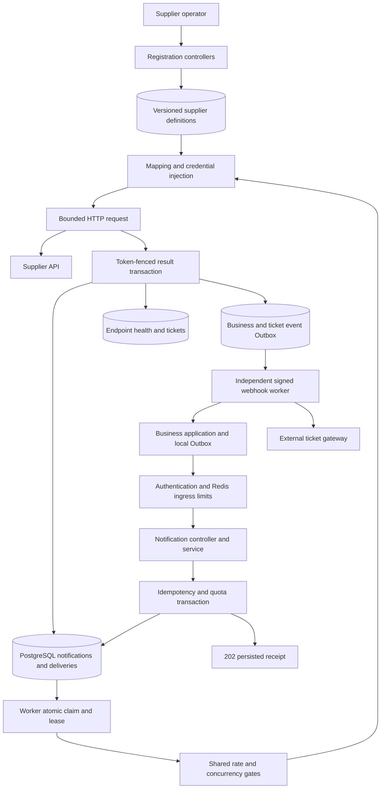
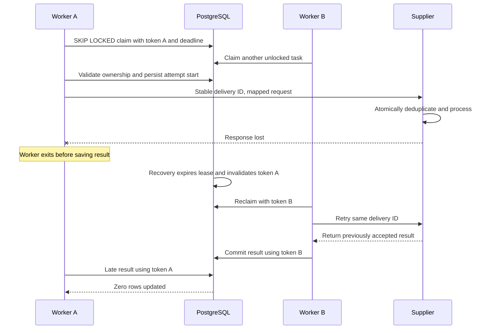
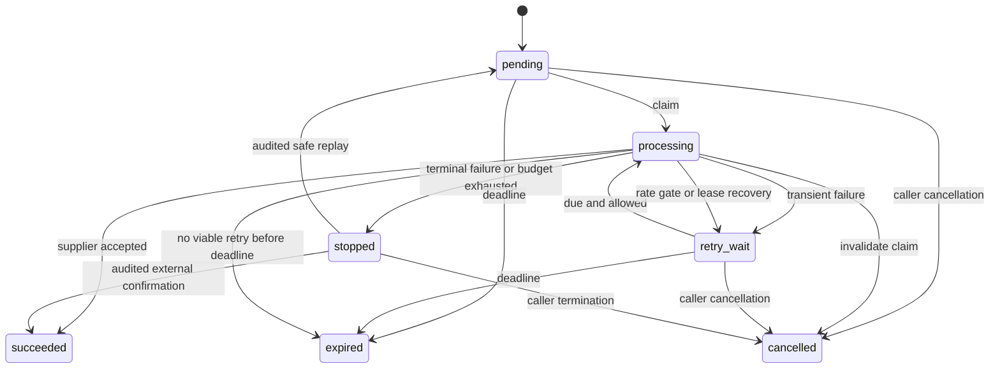
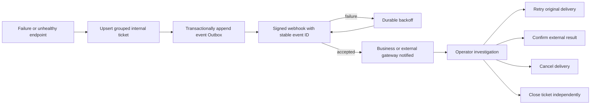

# Architecture and failure handling

## Atomic reception

The tenant quota row is locked before checking the idempotency key. All target validation, the notification row, its deliveries, and the new-delivery quota increment are in one transaction. A duplicate response can be reconstructed from existing tasks without spending another task quota. The database uniqueness constraint is a second guard against duplicate keys.

## Worker ownership

The database token protects database state, not external side effects. Expiring Redis concurrency slots limit normal traffic but are also not an exactly-once mechanism. Supplier-side atomic deduplication is mandatory for operations such as inventory changes.

## Delivery lifecycle

Each replay retains the delivery UUID and historic attempt count. A new replay round gets a fresh per-round attempt budget, but never extends the original expiration or deduplication deadline. Cancellation cannot recall an HTTP request already in flight.

## Incident lifecycle

External ticket delivery failure cannot erase the internal ticket. Exhausted Outbox events remain queryable and replayable. Monitoring of the Outbox must use infrastructure independent of the failing outbound channel.

## Circuit lifecycle

Health is shared per tenant connection and capability. Systemic failures move healthy -> degraded -> open. Open circuits suppress claims until the cooldown ends. The health row is locked when starting a probe, admitting one recovery attempt per circuit. Failure reopens the circuit; two successful probes restore healthy state. State transitions and periodic reminders notify only the owning tenant.

## Scope decisions

- PostgreSQL is the initial task queue and authoritative state store. Redis handles shared traffic controls.
- Outbox events are persisted atomically with business state. There is no database-to-broker dual write.
- Published configurations are immutable. Updating a supplier creates a new version for new notifications.
- Supplier responses indicate delivery acceptance, not necessarily asynchronous business completion.
- The browser console uses the same controllers as other API clients. API keys stay in memory; the optional loopback development gateway injects demo identities only on the server side.
- Strict ordering, custom executable adapters, weighted fair scheduling, email paging, and vendor-specific ticket APIs are extension work rather than hidden guarantees.
